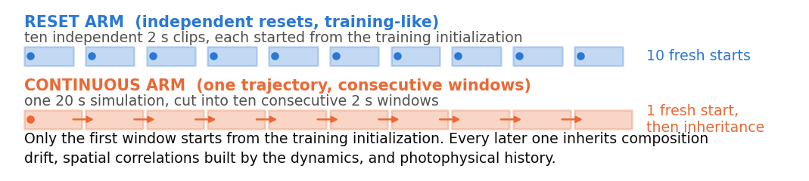

# Short Simulators, Long Experiments

**A Controlled Audit of Horizon Mismatch in Simulation-Based Inference for Live-Cell Microscopy**

Michael Alexander Ramirez Sierra and Roberto Covino

*Sim2Science: ML with Imperfect Scientific Models · NeurIPS 2026*

[Read the paper](paper/main.pdf) · [LaTeX source](paper/main.tex) · [Camera-ready self-assessment](paper/SELF_ASSESSMENT.md)

We investigate whether a neural posterior estimator trained on short, independently initialized
simulations remains reliable when applied to consecutive windows of a longer recording.
In live-cell microscopy, later windows inherit changes in receptor populations, spatial
organization, and fluorescence history. Those histories are absent from independently initialized
training clips.

## The controlled comparison

Using a reaction-diffusion model of receptor dimerization and synthetic microscopy, we compare
two audit arms at **500 matched parameter settings**:

- **Reset:** ten independently initialized 2-second simulations.
- **Continuous:** ten consecutive 2-second windows from one 20-second simulation.

Both arms use the same parameters, dynamics, imaging model, and fixed neural estimator.
**Every estimator input is 2 seconds long.** Exact simulator truth lets us measure how inference
changes as recording history accumulates.



## Main findings

By the final window, the effect depends on the inferred quantity:

| Quantity | Mean absolute error: reset → continuous window 10 | Assessment |
| --- | --- | --- |
| Dimer-complex fraction | 2.9 → 8.3 percentage points | Additional error exceeds the prespecified tolerance |
| Dimer unbinding rate | ×1.53 → ×3.02 | Additional error exceeds the prespecified tolerance |
| Monomer diffusion coefficient | ×1.05 → ×1.07 | Additional error remains within tolerance |

The dimer-complex fraction counts dimers among molecular complexes. For rates and diffusion,
the × values are 10 raised to the mean absolute log10 error. The tolerances are defined from
held-out recovery performance; the paper reports the paired contrasts and confidence intervals.

For composition, coverage of the central **90% credible interval falls from 95% to 39%**, while
the intervals narrow slightly. Averaging windows reduces total error but does not remove the
additional error associated with inherited history.

Applied as an uncalibrated sensitivity calculation, the simulated effect is small relative to
the inferred difference between resting and InlB-activated MET recordings. This comparison does
not correct experimental estimates or establish the cause of their temporal trends.
The findings characterize the tested simulator, estimator, and deployment pattern.

## Reproduce the figures and numerical checks

The included analysis runs on CPU from saved results. Create the minimal environment and run:

```bash
git clone https://github.com/covinolab/short-simulators-long-experiments.git
cd short-simulators-long-experiments
conda env create -f environment.yml
conda activate short-simulators-long-experiments

python figures/make_paper_figures.py
python evidence/camera_ready_checks/local_checks.py
```

The first script regenerates **Figures 1–4** as PDFs and PNGs and writes the sensitivity summary
to [`figures/census_transfer.md`](figures/census_transfer.md). The second recomputes the supplied
checks for Appendices A, E, and G and the experimental time-course values in Figure 4(b).

Definitions, bootstrap seeds, and execution order are documented in the
[numerical-check README](evidence/camera_ready_checks/README.md). The figure script uses a
separate bootstrap stream; its confidence-interval endpoints can differ from those quoted in
the paper by up to 0.1 percentage points.

To rebuild the paper with [Tectonic](https://tectonic-typesetting.github.io/):

```bash
cd paper
tectonic main.tex
```

## Repository contents

| Location | Contents |
| --- | --- |
| [`paper/`](paper/) | Camera-ready PDF, LaTeX source, bibliography, checklist, and self-assessment |
| [`figures/`](figures/) | Figure-generation script, generated figures, and sensitivity calculations |
| [`evidence/`](evidence/) | Saved audit, recovery, and experimental-inference results, reports, and numerical checks |
| [`code/`](code/) | Simulator and inference code snapshot used for the study |

The code snapshot is version **0.4.20**, commit **`2d24491`**, of
[`srm-and-sbi-dimer-alp`](https://github.com/srm-and-sbi/srm-and-sbi-dimer-alp).
[PROVENANCE.md](PROVENANCE.md) records its origin and the omission of one fleet-synchronization
helper. The [evidence manifest](evidence/MANIFEST.md) records archived sources and checksums and
identifies the derived camera-ready checks.

## Data access and reproduction scope

The bundled results support all figure generation and the supplied numerical checks.
Recomputing the **full audit analysis** and the **posterior interval-width statistics in
Appendix F** requires the 500 per-setting result files, including posterior draws and truths
(601 MB). These are available from the authors on request. Saved outputs document those
calculations; they do not replace the files needed to rerun them.

The simulated video corpora and trained estimator checkpoint are not included. Generating
corpora, training an estimator, or running the audit's simulation and inference phases requires
the [full scientific environment](code/srm-and-sbi-dimer-alp/env_snapshots/README.md) and the
computational resources described in Appendix H.

The experimental MET recordings are available through BioStudies, accession
[S-BSST712](https://www.ebi.ac.uk/biostudies/bioimages/studies/S-BSST712).
For the per-setting files, contact
[Michael Alexander Ramirez Sierra](mailto:ramirez-sierra@fias.uni-frankfurt.de).

## Contributors

**Michael Alexander Ramirez Sierra and Roberto Covino** are the authors of the study.
The research was developed with human-directed AI assistance:

| Contributor | Assistance |
| --- | --- |
| **ChatGPT / Codex (OpenAI)** | Scientific discussion, planning, review, numerical verification, visualization, writing, and release preparation |
| **Claude (Anthropic)** | Implementation, computational workflows, documentation, and manuscript revision |

The human authors directed the research, approved the scientific decisions and final claims,
and retain responsibility for the work. These assistants supported research development;
they are not components of the simulator, neural inference method, or statistical calculations
at execution time. The paper's checklist describes this assistance.

## Citation and license

Please cite the paper when using these materials. [CITATION.cff](CITATION.cff) provides the
author and citation metadata.

The repository uses the [MIT License](LICENSE). The original copyright notice is preserved,
including in the [code snapshot's license](code/srm-and-sbi-dimer-alp/LICENSE).
