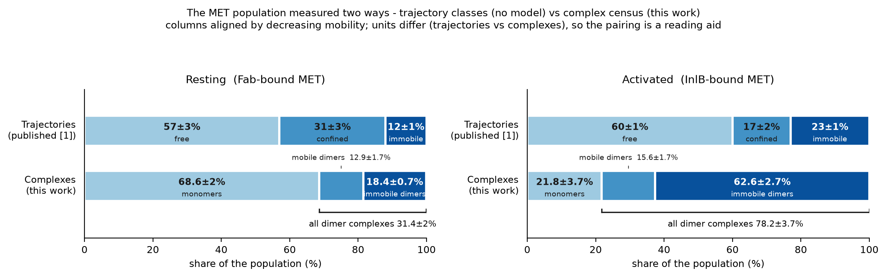
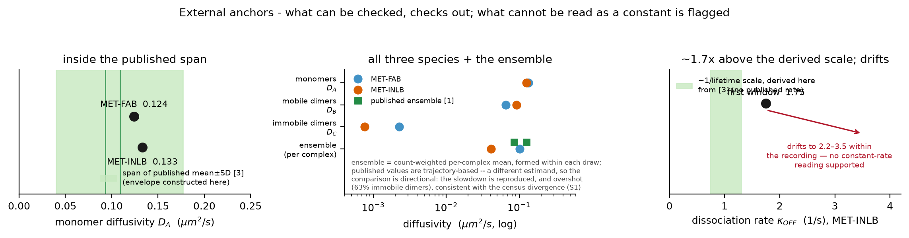
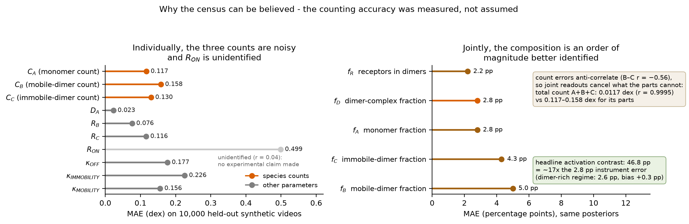
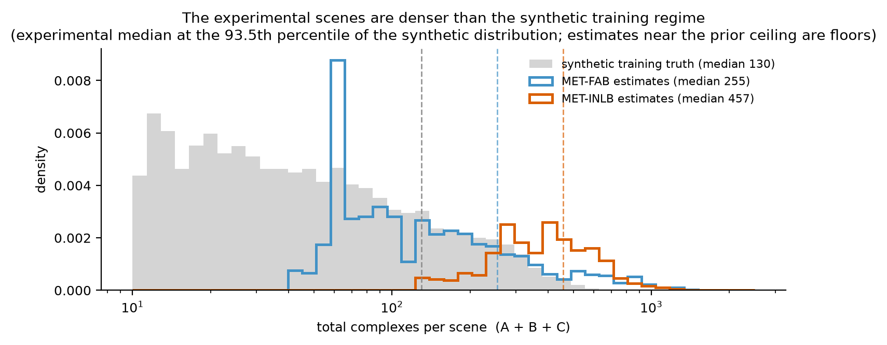
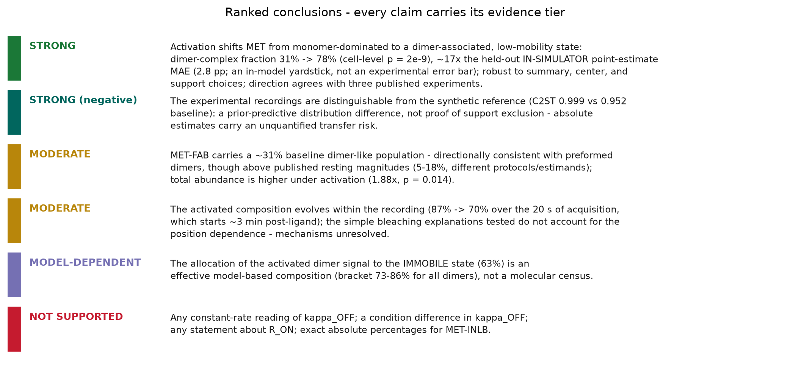

# Biology workflow at 2 s — presentation summary

A figure-led walk through the biology workflow's progress on the public MET recordings, one
figure per idea, in presentation order. Every number is traceable to the analyses on disk; the
full account is `report.md` in this directory, and the verbatim tables sit in Appendix A. New
summary figures (S1–S5) are regenerated by `make_summary_figures.py` beside this file; the other
figures (F1–F8) are the analyses' own outputs, reused. All paths in Appendix B.

**The pipeline in one paragraph.** An amortized neural posterior estimator (3D-CNN +
temporal-transformer embedding conditioning a masked autoregressive flow) is trained purely on
simulations of a three-species reaction–diffusion model — A monomers, B mobile dimers, C immobile
dimers — rendered through a calibrated microscope model into synthetic videos. Applied directly
to raw experimental single-particle-tracking videos (no tracking, no localization), it returns
per 2 s window the joint posterior over ten physical parameters. Data: the published MET
recordings of [1] (BioStudies S-BSST712), 25 cells per condition, 20 s each: MET-FAB (Fab-bound —
the resting, non-activating condition) and MET-INLB (the InlB-activated, dimerization-enriched
condition); both can contain monomer/dimer mixtures, and acquisition began ~3 min after ligand
addition [1], so the first recorded window is not the initial post-ligand state.

---

## 1 · The headline — the MET population, measured two ways — **S1**

- Same recordings, two independent routes: published *trajectory* classes (no model) above,
  our model-based *complex* census below; same color = closest mobility class.
- Resting-state numbers are close and the activation **direction** agrees across both methods —
  same-data mobility triangulation, not stoichiometric validation (motion class ↔ species has no
  established mapping). The **magnitude** diverges because the model concentrates everything
  slow, bright, and persistent into the immobile-dimer state — an effective model state, not a
  molecular census.
- The all-dimers bracket (31% → 78%) has no counterpart in [1]. Stoichiometric comparators:
  [2] reports 18% → 29% dimer-spot fractions its authors expect to underestimate (protocol-
  specific, not transferable bounds); [4] (detection-corrected qPALM) reports 5 ± 1% → 63 ± 2%
  (68 ± 4% ligand-colocalized). Activated magnitude ≈ consistent (63–68% vs our 78%); our
  resting 31% sits ABOVE the published resting estimates (5–18%) — different protocols and
  estimands, none is ground truth.
- *Caveat:* the census is a 20 s time average; the activated composition evolves within the
  recording (figure F3).
- **Window-slicing bias, now measured** (horizon audit, 500 simulated recordings, §8): reading a
  continuous recording in consecutive 2 s windows biases the dimer-complex fraction **upward**,
  by **+2.6 pp [1.9, 3.4]** on a 20 s time average (growing to +4.5 pp in the last window). It
  acts on both conditions — **+3.4 pp** resting-like, **+1.9 pp** activated-like — so it moves
  the 46.8 pp contrast by only **−1.5 pp (3%)**, leaving the measured contrast slightly
  conservative. The contrast is robust; the absolute values sit about **2–3 pp high**, which
  under direct transfer would put them near **28%** and **76%** — a sensitivity calculation, not
  a correction: simulator-to-experiment transfer is uncalibrated. (Numbers recomputed on the
  completed 500-recording cohort, 2026-08-26.)

## 2 · External anchors — what can be checked, checks out — **S2**

- D_A inside the span of the published donor-only values (0.109 ± 0.068 / 0.093 ± 0.053 µm²/s,
  mean ± SD [3]) in both conditions, essentially unchanged by activation. The 0.040–0.177
  envelope shown is a union of those mean ± SD ranges constructed in this project — not a
  published interval.
- The middle panel shows **all three species**: D_B ≈ 0.07–0.09 µm²/s, D_C ≈ 0.001–0.002 µm²/s
  (immobile, as designed), each formed within posterior draws so the D_B = R_B·D_A correlations
  survive.
- The count-weighted per-complex **ensemble** falls 0.102 → 0.041 µm²/s under activation —
  the published trajectory-based slowdown (0.126 → 0.085) reproduced in direction and overshot
  in magnitude, consistent with the 63%-immobile allocation (S1). Different estimands
  (per-complex versus per-trajectory), so the comparison is directional.
- κ_OFF: no dissociation rate is published; [3] reports apparent complex lifetimes of order 1 s
  (1.13 ± 0.06, 0.80 ± 0.03 s), inverted HERE into a ~1 1/s comparison scale (an effective
  termination scale, not the model's B → A+A rate). The estimate drifts within the recording, so
  no constant-rate reading is supported (tier table, S5).

## 3 · Why the census can be believed — the counting, measured — **S3 + F4**

- Left: on 10,000 held-out synthetic videos the three counts are individually the noisiest
  continuous parameters, and R_ON is unidentified (stated unprompted).
- Right: their errors anti-correlate, so the **joint** readouts cancel what the parts cannot —
  total count 0.0117 dex, composition 2.2–5.0 pp; the headline contrast is ~17× the f_D held-out, in-simulator point-estimate MAE (an in-model yardstick, not an experimental error bar).
- F4 (`composition_recovery.png`) shows the same 2.8 pp claim as a true-versus-inferred scatter;
  F5 (one raw count panel) shows the honest per-count noise and the ~32-receptor counting floor.
- Count credible intervals are conservative (coverage 0.93 vs nominal 0.90), with two documented
  exceptions at the one-receptor floor and for sub-1% species.

## 4 · The experimental readout — **F1 · F2 · F3**

- **F1 — per-condition composition.** Dimer-complex fraction 31.4 ± 2.0% (MET-FAB) versus
  78.2 ± 3.7% (MET-INLB); cell-level Mann–Whitney p ≈ 2×10⁻⁹ over 25 vs 25 cells. The recording
  — never the window — is the replicate.
- **F2 — every cell individually.** The contrast is carried by the population of cells, not by
  outliers.
- **F3 — within-recording time course.** MET-INLB relaxes 87.0% → 70.2% across the 20 s of
  acquisition (first-vs-last p = 0.0015; recording starts ~3 min post-ligand); MET-FAB stays
  flat (p = 0.52). The simple photobleaching explanations tested (magnitude, control, sign) do
  not straightforwardly account for the position dependence; biological and acquisition
  mechanisms remain unresolved. The horizon audit (§8) **excludes window-slicing as the cause**:
  that artifact biases late windows **upward** (+3.0 pp across a recording), i.e. against the
  observed −16.8 pp decline, so the underlying decline is if anything **steeper** than measured.

## 5 · Where the experimental data sit — the audit slides — **S4 + F6 + F7**

- **S4** — the experimental scenes are denser than the synthetic training regime (experimental
  median at the ~94th percentile of the synthetic distribution). Medians in S4 are over
  per-window MAP totals; the anchor table's 267/503 are cell-level aggregates (Appendix A).
- **F6 — embedding-space distance.** Experimental windows are distinguishable from the synthetic
  reference (C2ST 0.999 vs a 0.952 majority-class baseline; MMD 0.58): a **prior-predictive
  distribution difference** — not support exclusion, structural misspecification, or bias in any
  particular parameter. Absolute estimates carry an unquantified transfer risk; hence the tiers.
- **F7 — prior support.** MET-INLB count estimates press against the trained prior ceiling of
  316 receptors/species (44% of its count-draw mass outside the box) → those counts are floors.
  The composition headline survives excluding all out-of-support mass.

## 6 · Qualitative close — **F8**

- A real MET-INLB recording beside a synthetic one rendered from that cell's own inferred
  parameters: shared color limits, shared-bin intensity histograms, per-quantile match. One
  glance verifies the fitted model renders videos that look like the data.

## 7 · Ranked conclusions — **S5**

Every claim carries its evidence tier; the "not supported" row is presented as deliberately as
the "strong" one. Section 8 below refines two of these tiers with the window-slicing audit: the
within-recording decline moves **up** in confidence (its most obvious mechanical explanation is
excluded), and the kappa_OFF drift is now ~22% mechanically explained.

## 8 · The window-slicing audit — what it changes (completed)

The estimator reads **2-second** clips, and every clip it trained on started *fresh*: particles
placed at a known configuration, then two seconds of motion. But a real recording is **20 seconds**,
so it is cut into ten consecutive pieces and each is read separately. Piece 1 resembles training;
piece 10 does not — by then twelve seconds of chemistry and photobleaching have already happened.

A controlled audit over **500 simulated recordings** measured what that costs. Each simulated
parameter set was rendered twice: once as one continuous 20 s recording cut into ten windows (the
deployment condition), and once as ten independently initialized 2 s clips (the training condition,
called **ideal conditions** below — the best the estimator can possibly do, because it is exactly
what it was trained on). Everything else was held identical, so the difference isolates the effect
of inherited history.

**What "the estimate" is.** Every window is summarized from **1,000 draws of the trained
posterior** (direct flow sampling). For rates and speeds the estimate is the **median** of those
draws; for the dimer-complex fraction the fraction is formed *inside each draw* and then averaged, so the
count-to-count correlations survive. This is deliberately **not** the seed-then-optimize MAP the
Experiment stage uses — every audited quantity is a posterior functional, and sampling is far
cheaper per window. (Consequence: the experimental drift figures elsewhere in this report are
MAP-based, so a direct slope-to-slope comparison needs them recomputed from the stored posterior
quantiles first.)

**The reference, stated once.** Every number in the table below is referenced to the **true
simulated value** — for rates and speeds the parameter the simulator was given; for the paired
fraction that window's own true starting population. Nothing below is referenced to the
fresh-clip ensemble.

**How to read the units.** For rates and speeds the error is multiplicative, so it is quoted as a
percentage of the true value: **±50% means typically off by half the true value**, **±200% means
off by a factor of three**. For the dimer-complex fraction the unit is **percentage points (pp) of the
population**: ±3 pp means miscounting 3 receptors in every 100.

**Accuracy and direction are different numbers, and both are needed.** *Accuracy* averages how far
off an estimate is, ignoring sign — it never cancels, so it is large. *Direction* averages the
errors with their signs, so over- and under-estimates partly cancel — it is smaller, and it is the
part that does **not** average away with more data. For kappa_OFF at window 10, for instance, 60%
of recordings come out too high and 40% too low: the over-estimates average x3.3 and the
under-estimates x0.37, which is why accuracy reads ±202% while the direction reads only +37%.

| quantity | ideal conditions | window 1 | window 10 | direction at window 10 |
|---|---|---|---|---|
| monomer speed D_A | ±5% | ±5% | **±7%** | −2% |
| **dimer-complex fraction f_D** | ±2.9 pp | ±2.9 pp | **±8.3 pp** | **+4.3 pp — over-reports pairing** |
| **unpairing rate kappa_OFF** | ±54% | ±53% | **±202% (factor 3)** | **+37% — over-reports** |
| becoming-stuck rate kappa_IMM | ±74% | ±74% | ±173% | +1% — no clear direction |
| becoming-mobile rate kappa_MOB | ±50% | ±51% | ±125% | −11% — under-reports |
| pair speed ratio R_B | ±19% | ±19% | ±36% | +12% — over-reports |
| stuck-pair speed ratio R_C | ±33% | ±33% | ±62% | 0% — no clear direction |
| pairing rate R_ON | ±244% | ±244% | ±245% | −10% (unmeasurable either way) |

**Window 1 matches ideal conditions in every row.** That is the control: the estimator is
essentially unbiased when it reads the start of a recording, so everything in the window-10 column
is accumulated history rather than a defect of the estimator or of the comparison.

**The directions tell one coherent story.** Late in a recording the scene is dimmer and sparser
(bleaching, depletion), and the model reads that as a *more chemically active* scene: more pairs
present, unpairing faster, immobilizing faster, releasing more slowly. Molecules that have gone
dark look like molecules that have reacted. That single misreading explains every row above.

**Two controls make the result interpretable.** The **first** window of a continuous recording is
statistically indistinguishable from a fresh clip (differences of 0.001–0.004, intervals covering
zero), so the damage is genuinely inherited history and not an artifact of how the comparison was
built. And the degradation **persists inside the trained prior range** (2.6 → 6.8 pp for the 139
recordings whose true state never leaves it), so it is not merely extrapolation.

**A separate finding.** In **53%** of late windows the true state has left the trained parameter
range entirely — usually because a species goes **extinct** (a count reaches zero, which a
log-uniform prior cannot represent), and in 20% because monomers accumulate past the ceiling as
pairs dissociate. Receptors are exactly conserved throughout; what changes is how they are
partitioned into particles, and a box prior on per-species counts is not closed under the model's
own reactions. Those windows carry roughly 2 pp of additional error on top.

### What this changes for the results above

- **The condition contrast is safe.** Measured as the excess over fresh clips (the paired
  contrast, which isolates the windowing effect), the bias hits both conditions — **+3.4 pp**
  resting-like, **+1.9 pp** activated-like — so it moves the 46.8 pp contrast by **−1.5 pp,
  3% of it**, leaving the measured contrast slightly conservative.
- **The absolute values sit ~2–3 pp high** (+2.6 pp [1.9, 3.4] on a 20 s average); under direct
  transfer they would sit near **28%** and **76%**. This is a sensitivity calculation, not a
  correction: simulator-to-experiment transfer is uncalibrated.
- **The within-recording decline is strengthened, not weakened.** The artifact pushes late windows
  **up**, against the observed −16.8 pp decline, so the true decline is if anything steeper.
- **The in-simulator horizon trend is one fifth to one quarter of the kappa_OFF rise in
  magnitude** (slope-based, like the experimental report: +0.092 dex, ×1.24 across a recording,
  against +0.454 / +0.344 dex observed; one third to two fifths by window 10 minus window 1). Same
  direction as the data, but a comparison of scales, not an explanation; the remainder still
  needs photobleaching or biology.
- **D_A is untouched** — the added error is three times smaller than its own.

Still open: extending the count prior above its 316-receptor ceiling and below its 1-receptor floor
(the extinction finding), and a boundary-state-matched control arm to separate inherited history
from the changed composition itself.

---

## Appendix A — the tables behind the figures

**A1. Published trajectory classification** (fraction of trajectories; mean ± SEM, N = 60 cells [1]):

| condition | free | confined | immobile | all dimers |
|---|---|---|---|---|
| Fab/MET (resting) | 57 ± 3% | 31 ± 3% | 12 ± 1% | — |
| InlB/MET (activated) | 60 ± 1% | 17 ± 2% | 23 ± 1% | — |

**A2. This work — model-based complex census** (fraction of complexes; mean ± SEM, n = 25 cells;
time-averaged over 20 s):

| condition | monomers | mobile dimers | immobile dimers | all dimers |
|---|---|---|---|---|
| MET-FAB (resting) | 68.6 ± 2.0% | 12.9 ± 1.7% | 18.4 ± 0.7% | 31.4 ± 2.0% |
| MET-INLB (activated) | 21.8 ± 3.7% | 15.6 ± 1.7% | 62.6 ± 2.7% | 78.2 ± 3.7% |

**A3. External anchors** (report §1.2):

| observable (units) | published | this work — MET-FAB | this work — MET-INLB | reading |
|---|---|---|---|---|
| monomer diffusivity D_A (µm²/s) | 0.109 ± 0.068 and 0.093 ± 0.053 (mean ± SD [3]; the 0.040–0.177 envelope is constructed here) | 0.124 | 0.133 | inside the published span |
| ensemble diffusivity (µm²/s) | Fab 0.126 ± 0.005; InlB321 0.085 ± 0.003 [1] | 0.124 (scene ~70% monomer) | slowdown via composition shift | agrees; consistent |
| dissociation rate κ_OFF (1/s) | none published; apparent lifetimes ~1 s [3], inverted here into a ~1 1/s scale | drifts within recording | 1.75 (first recorded window) → 2.20; 2.8–3.5 aggregated | ~1.7× above the derived scale; no constant-rate reading |
| total complex abundance (per scene, cell-level medians) | not reported [1–3] | 267 | 503 (1.88×, p = 0.014) | internal contrast only |

**A4. Per-parameter recovery** (10,000 held-out synthetic videos; report §3.1):

| parameter | MAE (dex) | r | within [0.50×, 2.00×] | within [0.71×, 1.41×] |
|---|---|---|---|---|
| count_alp (C_A) | 0.117 | 0.967 | 88.6% | 72.8% |
| count_bet (C_B) | 0.158 | 0.938 | 83.0% | 66.3% |
| count_chi (C_C) | 0.130 | 0.960 | 87.2% | 71.0% |
| diffusivity_alp (D_A) | 0.023 | 0.993 | 100.0% | 99.4% |
| relative_diffusivity_bet (R_B) | 0.076 | 0.721 | 99.5% | 85.8% |
| relative_diffusivity_chi (R_C) | 0.116 | 0.827 | 91.7% | 73.2% |
| relative_rate_dimerization (R_ON) | 0.499 | 0.040 | 29.8% | 14.7% |
| rate_dissociation (κ_OFF) | 0.177 | 0.899 | 82.4% | 58.3% |
| rate_immobility | 0.226 | 0.832 | 73.6% | 49.7% |
| rate_mobility | 0.156 | 0.919 | 85.8% | 63.4% |

**A5. Derived-composition recovery** (fractions formed inside each posterior draw; report §3.2):

| derived quantity | definition | MAE | p95 abs. error |
|---|---|---|---|
| total complex count | A + B + C | 0.0117 dex (factor 1.027; r = 0.9995) | — |
| monomer fraction f_A | A / (A+B+C) | 2.8 pp | 8.3 pp |
| mobile-dimer fraction f_B | B / (A+B+C) | 5.0 pp | 15.8 pp |
| immobile-dimer fraction f_C | C / (A+B+C) | 4.3 pp | 14.5 pp |
| dimer-complex fraction f_D | (B+C) / (A+B+C) | 2.8 pp | 8.3 pp |
| receptors in dimers f_R | 2(B+C) / (A+2B+2C) | 2.2 pp | 7.1 pp |

Dimer-rich regime (true f_D > 0.7, n = 5,634 windows): MAE 2.6 pp, bias +0.3 pp.

## Appendix B — figure index

New summary figures (this directory, `figures/`; regenerate with `make_summary_figures.py`):

| # | file | one-line caption |
|---|---|---|
| S1 | `figures/S1_census_two_ways.png` | The population measured two ways, mobility classes color-aligned. |
| S2 | `figures/S2_external_anchors.png` | Published bands versus this work's estimates; κ_OFF drift flagged. |
| S3 | `figures/S3_counting_parts_vs_whole.png` | Counting accuracy: noisy parts, well-identified whole. |
| S4 | `figures/S4_scene_abundance.png` | Experimental scene density versus the synthetic training regime (computed live from the arrays). |
| S5 | `figures/S5_conclusions_ladder.png` | Ranked conclusions with evidence tiers. |

Reused analysis figures (paths relative to `Data_Bank/Posit/`):

| # | file | one-line caption |
|---|---|---|
| F1 | `SRM_AND_SBI_DIMER_ALP_2S_50FPS_Experiment_Population_Composition/figures/composition_conditions.png` | Per-condition composition with cell-level SEM — the headline contrast. |
| F2 | `SRM_AND_SBI_DIMER_ALP_2S_50FPS_Experiment_Population_Composition/figures/composition_per_cell.png` | Every recording individually — not carried by outliers. |
| F3 | `SRM_AND_SBI_DIMER_ALP_2S_50FPS_Experiment_Population_Composition/figures/composition_time_course.png` | Within-recording dynamics: MET-INLB relaxes, MET-FAB flat. |
| F4 | `SRM_AND_SBI_DIMER_ALP_2S_50FPS_Experiment_Population_Composition/figures/composition_recovery.png` | True versus inferred composition on held-out videos (the 2.8 pp claim). |
| F5 | `SRM_AND_SBI_DIMER_ALP_2S_50FPS_MAP_Recovery/figures/recovery_count_bet.png` | Raw per-count recovery — honest noise and the ~32-receptor floor. |
| F6 | `SRM_AND_SBI_DIMER_ALP_2S_50FPS_Embedding_Space_Distance/figures/pca_scatter.png` | Experimental versus synthetic embedding geometry — the measured gap. |
| F7 | `SRM_AND_SBI_DIMER_ALP_2S_50FPS_Experiment_Sample_Geometric_Median_MET-INLB/figures/out_of_prior_mass.png` | Posterior mass against the count-prior ceiling — counts as floors. |
| F8 | `SRM_AND_SBI_DIMER_ALP_2S_50FPS_Posterior_Predictive_Video/SRM_AND_SBI_DIMER_ALP_2S_50FPS_MAP_Estimate_SGM_MET-INLB_Cell_0_20S_Comparison.png` | Experimental recording beside a synthetic render from its own inferred parameters. |

## Provenance

Sources: `report.md` (this directory),
`../SRM_AND_SBI_DIMER_ALP_2S_50FPS_MAP_Recovery/report.md`,
`../SRM_AND_SBI_DIMER_ALP_2S_50FPS_Experiment_Population_Composition/report.md`,
`../SRM_AND_SBI_DIMER_ALP_2S_50FPS_Embedding_Space_Distance/report.md`. Estimator:
`SRM_AND_SBI_DIMER_ALP_2S_50FPS_Estimator.npz` (TRAIN+TEST 200K+50K). Data: BioStudies S-BSST712.

## References

[1] M.-L. I. E. Harwardt, P. Young, W. M. Bleymüller, T. Meyer, C. Karathanasis, H. H. Niemann,
    M. Heilemann, M. S. Dietz, "Membrane dynamics of resting and internalin B-bound MET receptor
    tyrosine kinase studied by single-molecule tracking," *FEBS Open Bio* **7**(9):1422–1440 (2017).
    doi:10.1002/2211-5463.12285. Data: BioStudies accession S-BSST712.

[2] M. S. Dietz, D. Haße, D. M. Ferraris, A. Göhler, H. H. Niemann, M. Heilemann, "Single-molecule
    photobleaching reveals increased MET receptor dimerization upon ligand binding in intact cells,"
    *BMC Biophysics* **6**:6 (2013). doi:10.1186/2046-1682-6-6.

[3] Y. Li, M. S. Dietz, H.-D. Barth, H. H. Niemann, M. Heilemann, "Single-Molecule FRET-Tracking of
    MET Receptor Dynamics," *Small* **22**, e07115 (2026). doi:10.1002/smll.202507115.

[4] T. N. Baldering, C. Karathanasis, M.-L. I. E. Harwardt, P. Freund, M. Meurer, J. V. Rahm,
    M. Knop, M. S. Dietz, M. Heilemann, "CRISPR/Cas12a-mediated labeling of MET receptor enables
    quantitative single-molecule imaging of endogenous protein organization and dynamics,"
    *iScience* **24**(1):101895 (2021). doi:10.1016/j.isci.2020.101895.
