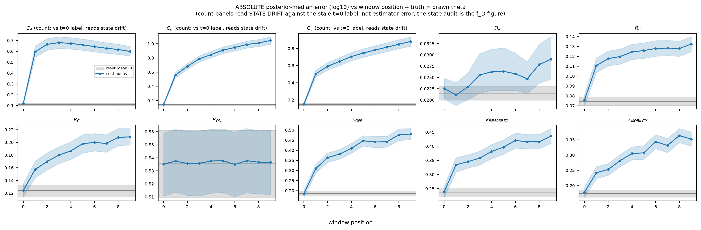
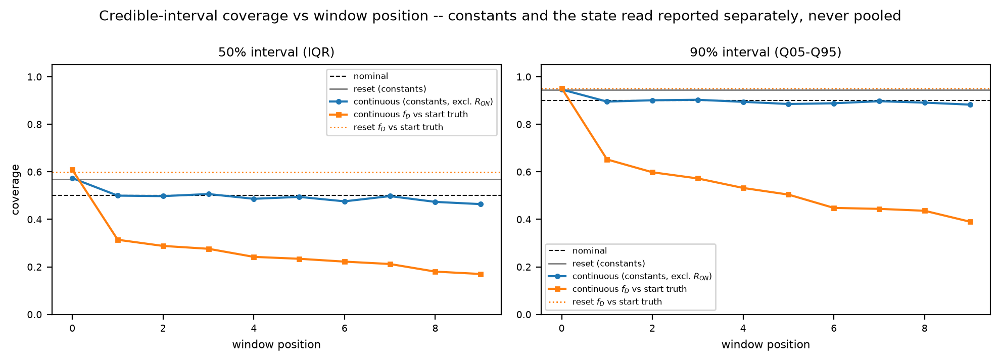
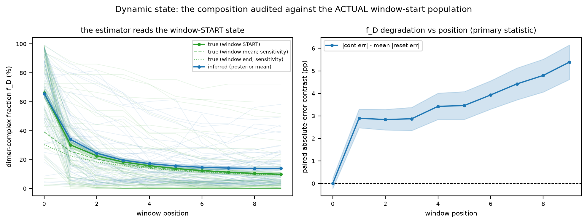
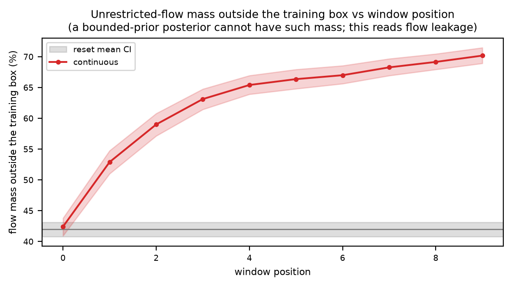

# Horizon_Audit diagnostics - SRM_AND_SBI_DIMER_ALP_2S_50FPS
Run: 2026-08-26 11:44:18 UTC

## Checks - 1 passed, 0 failed

| check | result | detail |
|---|---|---|
| first_window_exchangeable | PASS | f_D: +0.002 [-0.225, +0.225] pp; diffusivity_alp: +0.001 [-0.001, +0.003] dex; rate_dissociation: -0.001 [-0.014, +0.011] dex |

## Quantitative

| metric | value | expected | meaning |
|---|---|---|---|
| cohort_id | 936727a9bd6b | - | every artifact used below carried this stamp; mismatches are refused. |
| inference_config | pool=unrestricted, draws=1000, estimator 6339f60a359e | - | verified identical across every result file. |
| trajectories | 500 | - | complete (generated + inferred) theta draws; the independent unit. |
| windows_per_trajectory | 10 | - | - |
| resets_per_trajectory | 10 | - | - |
| true start-counts outside the training count box (%) | 52.52 | - | fraction of continuous windows whose TRUE start population leaves [10^0, 10^2.5] in any species -- state-support drift, distinct from any estimator behavior. |
| f_D degradation on trajectories that NEVER leave the count box | 2.43 -> 7.72 pp (w0 -> w9); paired delta +5.46 [+4.02, +6.94] pp, n = 92 | - | the extrapolation control: these trajectories' TRUE state stays inside the trained count support at every window, so their degradation cannot be explained by the estimator being queried off its training support. A degradation that survives here is a property of the inherited state itself. |
| flow mass outside the training box, reset (%) | 41.95 | - | unrestricted-flow draws outside the training box; a bounded-prior posterior cannot have such mass -- this reads flow leakage, the deployment gate of the experimental analysis. |
| flow mass outside the training box, continuous last window (%) | 70.17 | - | - |

## PRIMARY audit: paired absolute-error contrast with prespecified equivalence margins

| primary estimand | reset MAE | cont MAE (w0) | cont MAE (w9) | paired |err| delta (last w) | 95% CI | margin | detectable | verdict |
|---|---|---|---|---|---|---|---|---|
| f_D (state, vs window-start truth) | 2.927 pp | 2.929 | 8.319 | +5.392 | [+4.659, +6.169] | 2.8 pp | yes | degraded |
| diffusivity_alp (constant, vs theta) | 0.022 dex | 0.023 | 0.029 | +0.007 | [+0.003, +0.012] | 0.023 dex | yes | equivalent |
| rate_dissociation (constant, vs theta) | 0.186 dex | 0.184 | 0.480 | +0.295 | [+0.267, +0.323] | 0.177 dex | yes | degraded |

*the contrast is |continuous error| minus the mean |reset error| across the ten reset clips generated at the same parameter setting, at the LAST window (positive = continuous worse). The MARGIN decides the verdict, not zero: 'degraded' needs the whole CI above the margin, 'equivalent' the whole CI inside (-margin, +margin). 'Detectable' answers the separate question of whether the effect is distinguishable from zero -- a quantity can be detectable AND equivalent, which is the honest description of a real but practically negligible loss. Margins default to the estimator's own in-model error on the 10,000-video held-out recovery.*

## RECORDING-LEVEL audit: the production summary, not the individual window

| primary estimand | reset recording error | continuous recording error | paired delta | 95% CI | margin | verdict |
|---|---|---|---|---|---|---|
| f_D (state, vs window-start truth) | 1.708 pp | 5.564 | +3.856 | [+3.382, +4.367] | 2.8 pp | degraded |
| diffusivity_alp (constant, vs theta) | 0.013 dex | 0.019 | +0.006 | [+0.003, +0.009] | 0.023 dex | equivalent |
| rate_dissociation (constant, vs theta) | 0.139 dex | 0.346 | +0.206 | [+0.189, +0.224] | 0.177 dex | degraded |

*each recording's ten window estimates are averaged with the SAME operator the experimental workflow uses, then compared with the recording's truth; the contrast is again continuous minus reset at the same parameter setting. This is the operationally relevant number: the workflow reports one value per cell and treats the cell, never the window, as the biological replicate. A quantity whose individual windows degrade can still aggregate to a usable recording summary if the added error is zero-mean; one that carries a systematic shift does not, because averaging preserves a bias. The margin is the per-window scientific tolerance and is applied unchanged, which is conservative here: averaging ten windows reduces the noise floor but not the bias.*

## STRATIFIED robustness: per-stratum margins from the same held-out recovery set

| stratum (true value) | n cohort | n recovery | local margin | paired |err| delta (w9) | 95% CI | x margin | signed shift | verdict |
|---|---|---|---|---|---|---|---|---|
| diffusivity_alp 0.0562-0.121 | 169 | 3323 | 0.024 dex | -0.004 | [-0.007, -0.001] | -0.2x | -3% | equivalent |
| diffusivity_alp 0.121-0.261 | 170 | 3319 | 0.022 dex | +0.014 | [+0.007, +0.023] | 0.7x | -4% | inconclusive |
| diffusivity_alp 0.261-0.562 | 161 | 3358 | 0.021 dex | +0.012 | [+0.004, +0.024] | 0.6x | -3% | inconclusive |
| rate_dissociation 0.1-0.464 | 162 | 3368 | 0.210 dex | +0.468 | [+0.419, +0.518] | 2.2x | +241% | degraded |
| rate_dissociation 0.464-2.15 | 164 | 3307 | 0.158 dex | +0.132 | [+0.097, +0.170] | 0.8x | +77% | inconclusive |
| rate_dissociation 2.15-10 | 174 | 3325 | 0.168 dex | +0.286 | [+0.245, +0.330] | 1.7x | -51% | degraded |
| f_D start 0-0.2 | 417 | 1153 | 1.85 pp | +4.62 | [+3.86, +5.43] | 2.5x | +6.5 pp | degraded |
| f_D start 0.2-0.8 | 81 | 4174 | 3.60 pp | +8.81 | [+7.11, +10.54] | 2.4x | -7.2 pp | degraded |
| f_D start 0.8-1 | 2 | 4673 | 2.34 pp | +28.80 | [+26.31, +31.28] | 12.3x | -30.2 pp | degraded |

*strata are FIXED thirds of the prior range (prespecified geometry, not data-dependent quantiles; the prior is uniform in log10 so thirds carry equal expected mass), f_D in prespecified composition bins. The margin is the estimator's own held-out error for true values IN THAT STRATUM, so each verdict compares like with like. 'signed shift' is continuous minus the reset baseline at the same theta -- the horizon-specific bias, with each arm's generic prior shrinkage differenced out. A stratum thinly populated in the cohort is reported with its n, never dropped. The f_D margins here are point-composed from recovery medians (prior-averaged 2.81 pp) while the audit's f_D is composed INSIDE each draw (declared margin 2.8 pp); the small offset is stated, not silently mixed.*

## Exploratory parameters (no verdicts: not predeclared, no multiplicity control)

| parameter | reset MAE | cont MAE (w9) | paired |err| delta (last w) | signed delta (bias) | slope/window |
|---|---|---|---|---|---|
| count_alp (count: vs t=0 label -- reads state drift) | 0.110 | 0.599 | +0.488 | +0.400 | +0.0106 |
| count_bet (count: vs t=0 label -- reads state drift) | 0.143 | 1.046 | +0.902 | -0.988 | -0.0985 |
| count_chi (count: vs t=0 label -- reads state drift) | 0.147 | 0.882 | +0.735 | -0.853 | -0.0904 |
| relative_diffusivity_bet | 0.075 | 0.132 | +0.058 | +0.057 | +0.0034 |
| relative_diffusivity_chi | 0.124 | 0.209 | +0.084 | +0.005 | -0.0009 |
| relative_rate_dimerization (unidentified) | 0.535 | 0.537 | +0.001 | -0.005 | -0.0002 |
| rate_immobility | 0.238 | 0.436 | +0.198 | +0.072 | +0.0051 |
| rate_mobility | 0.174 | 0.352 | +0.178 | -0.032 | +0.0017 |

*count rows compare against the stale t=0 label and therefore read STATE DRIFT, not estimator error -- the state audit is the f_D primary above. R_ON is already known unidentified and never contributes to any verdict.*

## Interval coverage, disaggregated by estimand kind (never pooled)

| estimand (truth) | reset c50 / c90 | cont w0 c50 / c90 | cont w9 c50 / c90 |
|---|---|---|---|
| constants excl. R_ON (theta) | 0.57 / 0.94 | 0.57 / 0.95 | 0.46 / 0.88 |
| f_D (window-START truth, from draws) | 0.60 / 0.95 | 0.61 / 0.95 | 0.17 / 0.39 |
| counts (STALE t=0 truth -- state drift, expected to fail late) | 0.61 / 0.96 | 0.62 / 0.95 | 0.10 / 0.19 |

*nominal 0.50 / 0.90. The counts row is diagnostic context only: its late-window failure against the stale t=0 truth measures how far the state drifted, not calibration.*

## f_D error (pp MAE) under each truth reference

| truth reference | reset | continuous (all windows) |
|---|---|---|
| window START (PRIMARY) | 2.93 | 6.33 |
| window mean (sensitivity) | 27.00 | 9.00 |
| window end (sensitivity) | - | 10.34 |
| unrounded theta label (sensitivity, resets only) | 2.89 | - |

*the estimator's training labels are window-start populations, so START is the primary reference; the spread across references measures how much the truth choice alone moves the number (the estimand-mismatch hazard). The unrounded-label row isolates the count-rounding effect.*

## Exploratory: last-window f_D degradation by initial composition

| stratum | n trajectories | mean paired |err| delta (pp) |
|---|---|---|
| initial f_D < 0.4 | 115 | +4.85 |
| 0.4 <= initial f_D <= 0.7 | 109 | +5.61 |
| initial f_D > 0.7 | 276 | +5.53 |

*a prior-wide mean can hide failure in the dimer-rich region the activated experimental condition occupies; exploratory (no CI shown below n=6 per stratum, no verdicts).*

## What these mean

A check **PASS** means the invariant held; a **FAIL** aborts the run immediately with a located error message.

- **first_window_exchangeable** -- continuous window 0 has no inherited past, so it must be statistically exchangeable with the resets BEFORE later-window differences are attributed to horizon; failure here means an arm-construction artifact, not horizon.

## Figures

*Absolute posterior-median error (log10, truth = drawn theta) against window position: continuous (line, trajectory-bootstrap CI) against the reset mean (gray band). Count panels read state drift against the stale t=0 label.*

*Coverage against window position, disaggregated: constants (excluding the unidentified R_ON) against theta, and f_D against the window-start truth.*

*The state audit: inferred f_D against the actual window-START population (primary), with the window-mean and window-end truths as sensitivity references, and the paired absolute-error contrast per position.*

*Unrestricted-flow mass outside the training box against window position, continuous vs reset.*
